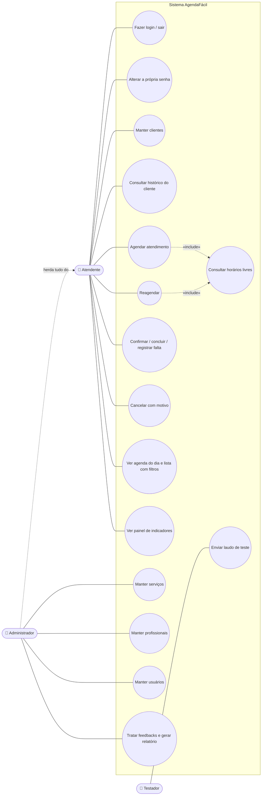
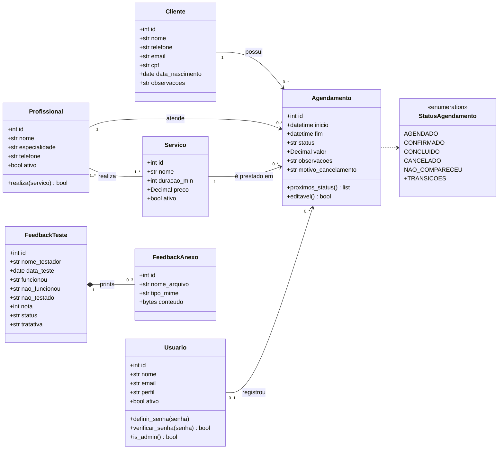
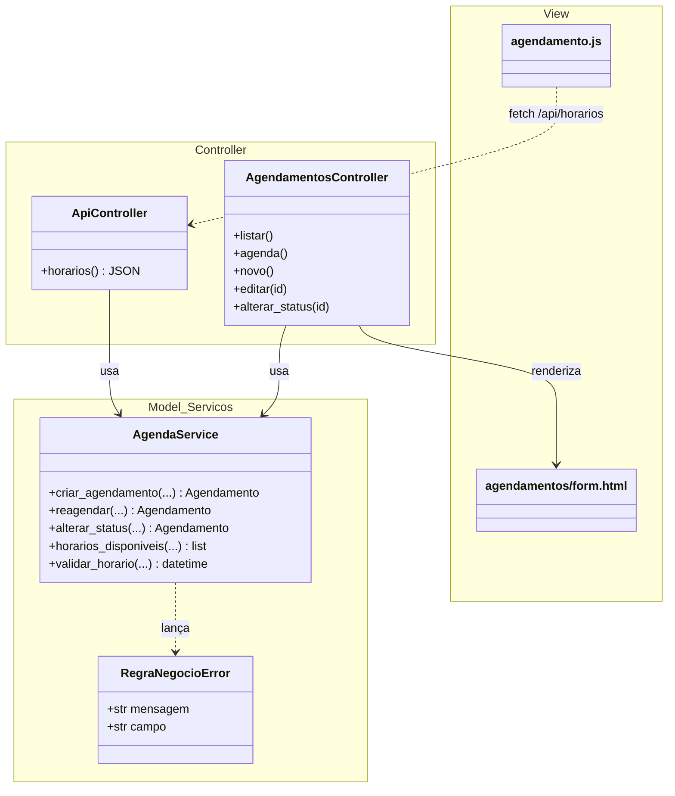
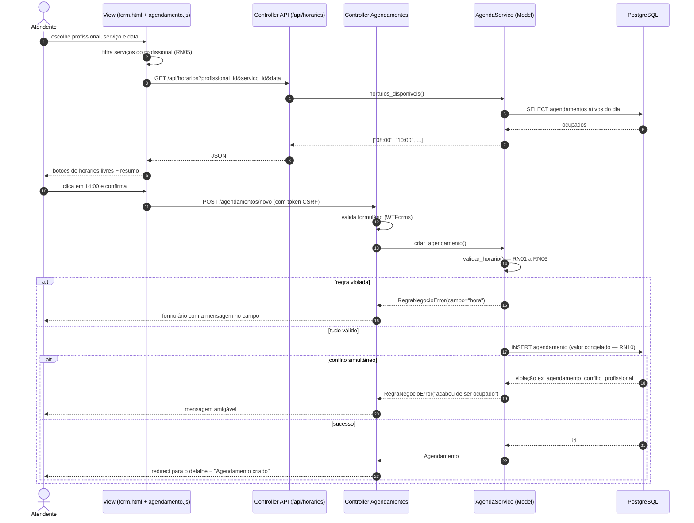
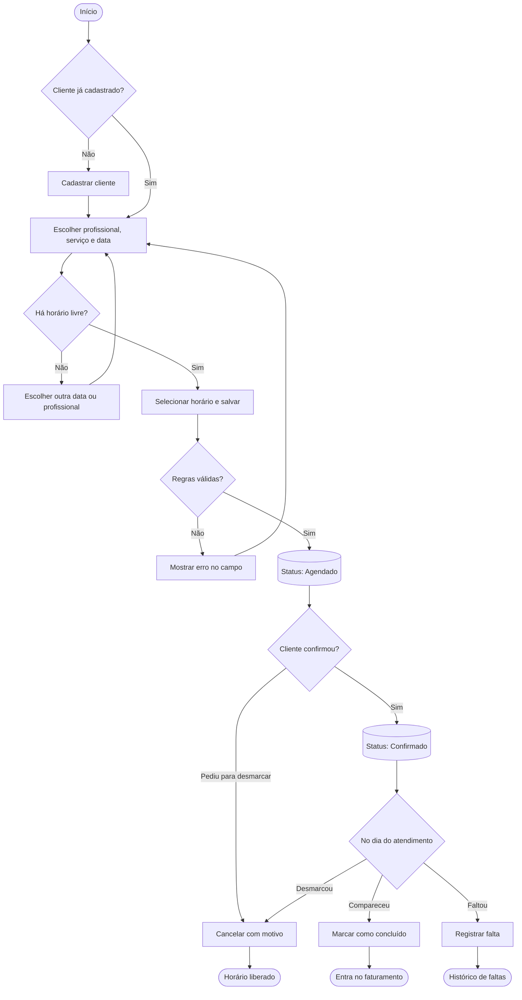
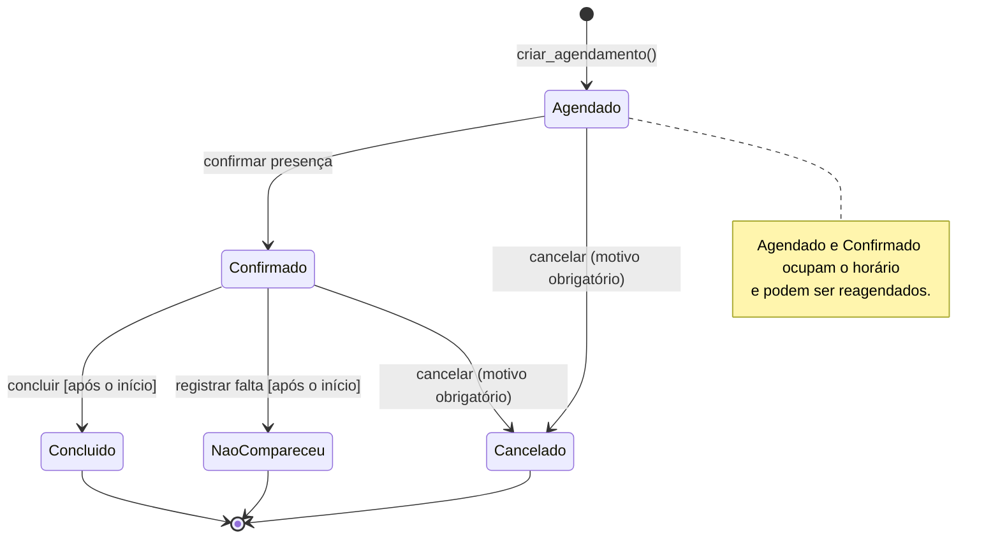
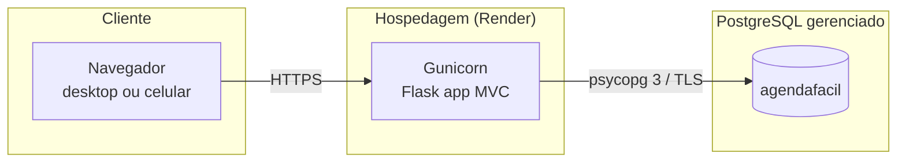

# 3. Modelagem UML (revisada)

> Os diagramas estão em **Mermaid**: o GitHub os desenha automaticamente e eles ficam
> versionados como texto junto com o código. Para exportar como imagem, use
> <https://mermaid.live> (cole o bloco e baixe em PNG/SVG).

## 3.1 Diagrama de casos de uso

**Especificação do caso de uso principal — UC05 Agendar atendimento**

| Item | Descrição |
|---|---|
| Ator | Atendente (ou Administrador) |
| Pré-condição | Usuário autenticado; existe ao menos um cliente, um serviço e um profissional ativos |
| Fluxo principal | 1. Atendente abre "Novo agendamento". 2. Escolhe o cliente. 3. Escolhe o profissional; o sistema mostra só os serviços que ele realiza (RN05). 4. Escolhe o serviço e a data. 5. O sistema consulta e exibe os horários livres (UC06). 6. Atendente clica em um horário; o resumo mostra duração, término e valor. 7. Atendente confirma. 8. O sistema valida RN01–RN06, grava com status "Agendado" e valor congelado (RN10) e mostra o detalhe com a mensagem de sucesso. |
| Fluxo alternativo A1 | Cliente não cadastrado: o atendente usa "Cadastrar novo cliente" → "Salvar e agendar", que volta para o agendamento com o cliente já selecionado. |
| Fluxo de exceção E1 | Horário ocupado ou fora do expediente: o sistema não grava e mostra a mensagem junto ao campo "Horário", mantendo os dados preenchidos. |
| Fluxo de exceção E2 | Dois atendentes salvam o mesmo horário ao mesmo tempo: o PostgreSQL rejeita o segundo (*exclusion constraint*) e o sistema exibe "Esse horário acabou de ser ocupado…". |
| Pós-condição | Horário ocupado na agenda do profissional; aparece no painel e no histórico do cliente. |

## 3.2 Diagrama de classes de domínio

## 3.3 Diagrama de classes da arquitetura (MVC em camadas)

## 3.4 Diagrama de sequência — agendar atendimento

## 3.5 Diagrama de atividades — atendimento do início ao fim

## 3.6 Diagrama de estados — Agendamento

## 3.7 Diagrama de implantação

