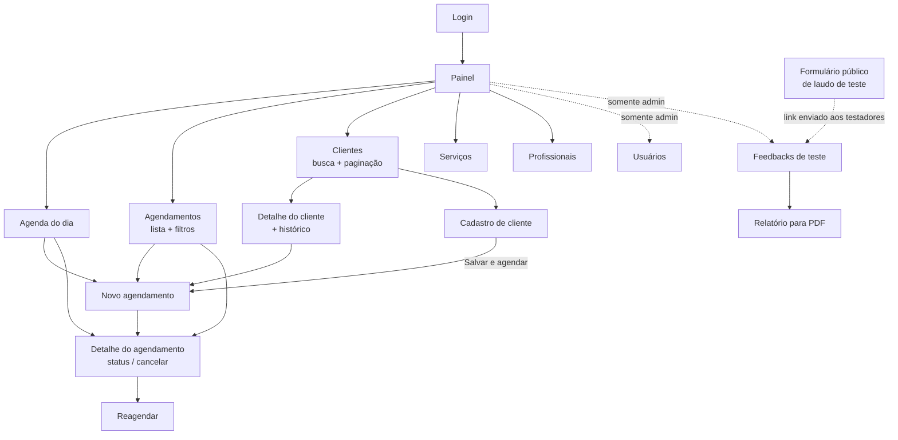
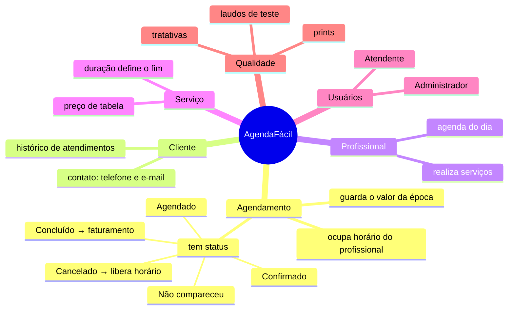

# 4. IHC — interface, protótipo e mensagens

> Situação-Problema 1: "Verifique e adeque os elementos da IHC para refletir o que você
> pretende desenvolver em nível de telas, mensagens de erro, mapas conceituais, além de
> revisar o próprio protótipo incrementando-o."

O protótipo evoluiu para as **telas reais** do sistema. As capturas abaixo saem do sistema
em funcionamento e são geradas automaticamente pelo script `scripts/capturar_telas.py`.

## 4.1 Princípios de IHC aplicados

| Princípio (material teórico) | Como foi aplicado no AgendaFácil |
|---|---|
| **Clara** | Rótulos em português simples, um título por página, campos obrigatórios marcados com `*` |
| **Consistente** | Mesmos componentes em todas as telas: botão primário verde à direita, "Cancelar" ao lado, selos coloridos de status, trilha de navegação no topo |
| **Simples** (divulgação progressiva) | O agendamento é dividido em 3 etapas numeradas; o cancelamento fica recolhido em "Cancelar este agendamento…" e só abre quando necessário |
| **Controlada pelo usuário** | Nada acontece sem clique; mensagens de sucesso podem ser fechadas; filtros só aplicam ao clicar em "Filtrar" |
| **Direta** (causa e efeito) | Clicar num horário o destaca e atualiza o resumo na hora (término e valor) |
| **Empática e recuperável** | Confirmação antes de excluir ou desativar; profissionais e serviços são desativados (reversível), não apagados; cancelamento preserva o histórico; o formulário com erro mantém tudo o que foi digitado |
| **Dá resposta** | Mensagens de sucesso e erro após toda ação; indicador "Buscando horários livres" durante a consulta; botão desabilitado com indicador de carregamento após o clique (evita envio duplo) |
| **Esteticamente agradável** | Paleta verde-azulada sóbria, cartões com bom espaçamento, tipografia com hierarquia (título → seção → rótulo), cores reservadas para significado (vermelho = erro/perigo, amarelo = atenção) |
| **Pense nos padrões** (campos pré-preenchidos) | Data de hoje já preenchida; "Agendar" a partir do cliente ou da agenda do profissional já traz cliente, profissional e data selecionados; lista abre a partir de hoje |
| **Comunique o que está acontecendo** | Trilha de navegação ("Painel / Agendamentos / #5"), item ativo destacado no menu, fluxo visual do status do atendimento |

**Elementos de interface usados** (conforme a classificação do material): controles de entrada
(campos de texto, data, listas suspensas, caixas de seleção, botões de opção para a nota),
componentes de navegação (trilha, menu lateral, campo de pesquisa, paginação, ícones),
componentes informativos (notificações, selos, indicador de progresso, janela modal, dicas nos
campos) e recipientes (cartões).

**Acessibilidade:** link "Pular para o conteúdo", foco visível em todos os controles, campos com
`<label>`, erros ligados ao campo por `aria-describedby` e anunciados por leitores de tela
(`aria-invalid`, `role="alert"`, `aria-live`), horários navegáveis pelas setas do teclado
(padrão *radiogroup*), contraste AA e respeito a `prefers-reduced-motion`.

## 4.2 Mapa de navegação (arquitetura da informação)

## 4.3 Mapa conceitual do domínio

## 4.4 Telas

| Tela | Captura |
|---|---|
| Login |  |
| Login — validação no navegador |  |
| Painel |  |
| Agenda do dia |  |
| Lista de agendamentos |  |
| Novo agendamento (horários livres) |  |
| Conflito de horário |  |
| Detalhe do agendamento |  |
| Clientes |  |
| Validação do cadastro de cliente |  |
| Histórico do cliente |  |
| Serviços |  |
| Profissionais |  |
| Usuários |  |
| Modal de confirmação |  |
| Formulário de laudo de teste |  |
| Página de erro 404 |  |
| Celular — painel / lista / menu |    |

## 4.5 Catálogo de mensagens

Regra de redação: dizer **o que aconteceu** e **o que fazer**, sem jargão técnico e sem culpar o usuário.

### Validação de campos (aparecem abaixo do campo, em vermelho, com ícone)

| Situação | Mensagem |
|---|---|
| Campo obrigatório vazio | Campo obrigatório. |
| Lista não selecionada | Selecione o cliente. / Selecione o profissional. / Selecione o serviço. |
| E-mail mal formado | E-mail inválido. |
| Telefone inválido | Telefone inválido. Use DDD + número, ex.: (11) 98765-4321. |
| CPF com dígito verificador errado | CPF inválido. Confira os números digitados. |
| Nome curto | Use entre 3 e 120 caracteres. |
| Senha fraca | A senha precisa ter ao menos 8 caracteres, com letras e números. |
| Confirmação de senha diferente | As senhas não conferem. |
| Duração do serviço fora da faixa | A duração deve ficar entre 5 e 480 minutos. |
| Horário em formato errado | Horário inválido (use HH:MM). |
| Nota do laudo não escolhida | Escolha uma nota de 1 a 5. |
| Data fora da faixa | Informe uma data entre 1900 e 2999. / Data de nascimento inválida. |
| Texto acima do limite do banco | Os campos não podem ter mais do que 120 caracteres. |
| Print inválido | O arquivo "x" não é uma imagem válida (use PNG, JPG, WEBP ou GIF). / A imagem "x" passa de 2 MB. / Envie no máximo 3 imagens. |

### Regras de negócio

| Regra | Mensagem |
|---|---|
| RN01 | Não é possível agendar em um horário que já passou. |
| RN02 | O atendimento precisa acontecer entre 08:00 e 20:00 (este serviço dura 60 min). / O estabelecimento não funciona neste dia. |
| RN03 | Ana Souza já tem um atendimento entre 10:30 e 11:30. Escolha outro horário. |
| RN03 (concorrência) | Esse horário acabou de ser ocupado por outro agendamento. Escolha outro horário. |
| RN04 | Maria Silva já tem outro atendimento marcado nesse período. |
| RN05 | Ana Souza não realiza o serviço "Barba". |
| RN07 | Não é possível mudar de "Cancelado" para "Agendado". |
| RN08 | Informe o motivo do cancelamento. |
| RN09 | Só é possível concluir ou registrar falta depois do horário do atendimento. |
| RN11 | Maria Silva possui 2 agendamento(s) no histórico e não pode ser excluído. Os dados são mantidos para preservar o histórico de atendimentos. |
| RN12 | Ana Souza tem 1 agendamento(s) futuro(s). Cancele ou transfira esses atendimentos antes de inativar. / O serviço “Barba” tem 1 agendamento(s) futuro(s). … |
| RN13 | Você não pode desativar a sua própria conta. / O sistema precisa ter ao menos um administrador ativo. |
| RN14 | Já existe um cliente cadastrado com este CPF. / Este e-mail já está em uso por outro usuário. |

### Autenticação e sistema

| Situação | Mensagem |
|---|---|
| Login errado (não revela se o e-mail existe) | E-mail ou senha incorretos. |
| Conta desativada | Sua conta está desativada. Procure um administrador. |
| Acesso sem login | Faça login para acessar esta página. |
| Sessão expirada na consulta de horários | Sua sessão expirou. Recarregue a página e faça login novamente. |
| Falha de rede ao buscar horários | Não foi possível carregar os horários agora. Você ainda pode digitar o horário manualmente. |
| 403 | Acesso negado — Seu perfil não tem permissão para acessar esta área. |
| 404 | Página não encontrada — O endereço acessado não existe ou o registro foi removido. |
| Token CSRF expirado | O formulário expirou por segurança. Volte, recarregue a página e tente de novo. |
| Upload acima do limite | Arquivo muito grande — O envio ultrapassou o limite de 8 MB. Reduza as imagens. |
| 503 | Banco de dados indisponível — Não foi possível conectar ao banco de dados. Verifique se o PostgreSQL está ligado e se o DATABASE_URL do arquivo .env está correto. |
| 500 | Erro interno — Algo deu errado do nosso lado. A equipe foi avisada; tente novamente. |

### Confirmações (modal)

| Ação | Texto |
|---|---|
| Excluir cliente | Excluir Fulano? Esta ação não pode ser desfeita. |
| Desativar serviço | Desativar "Corte"? Ele deixa de aparecer em novos agendamentos, mas o histórico é mantido. |
| Desativar profissional | Desativar Fulano? A pessoa deixa de aparecer para novos agendamentos. |
| Desativar usuário | Desativar email? A pessoa não conseguirá mais entrar. |
| Registrar falta | Registrar que Fulano não compareceu? |
