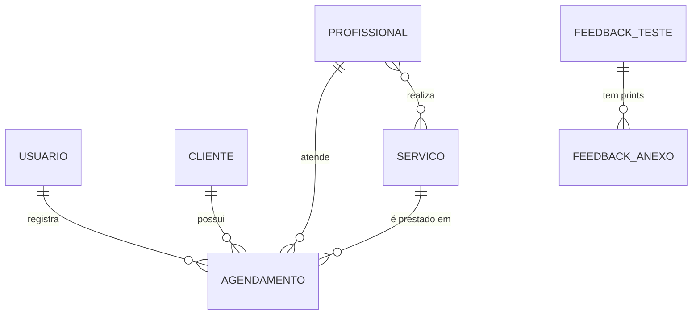
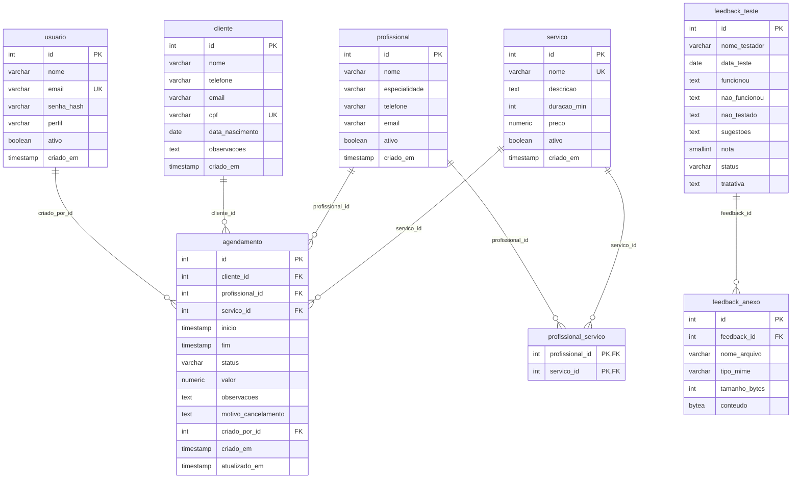

# 5. Projeto do banco de dados

> Situação-Problema 1: "Faça ou revise os projetos relacionados aos dados a partir do diagrama
> de classes de persistência (projeto conceitual, projeto lógico normalizado). Execute o projeto
> físico do banco de dados (...), documente-o e crie o dicionário de dados."

**SGBD escolhido: PostgreSQL** — livre, muito usado no mercado, disponível em todas as
hospedagens (Render, Neon, Supabase, AWS RDS etc.) e com recursos que permitem levar as regras
de dados para dentro do banco (domínios, CHECK e *exclusion constraints*).

## 5.1 Do diagrama de classes ao modelo relacional

Cada classe persistente do diagrama de classes (seção 3.2) vira uma relação (tabela). As
associações viram chaves estrangeiras; a associação N:N vira uma tabela associativa.

| Classe (UML) | Tabela | Observação do mapeamento |
|---|---|---|
| `Usuario` | `usuario` | Os métodos `definir_senha`/`verificar_senha` não viram colunas: só o resultado (`senha_hash`) é persistido |
| `Cliente` | `cliente` | — |
| `Servico` | `servico` | — |
| `Profissional` | `profissional` | — |
| associação `Profissional` *realiza* `Servico` (N:N) | `profissional_servico` | Tabela associativa com PK composta |
| `Agendamento` | `agendamento` | Associações com Cliente, Profissional, Servico e Usuario viram FKs |
| `StatusAgendamento` (enumeração) | coluna `agendamento.status` + `CHECK` | Enumeração pequena e estável: um `CHECK` basta, sem tabela extra |
| `FeedbackTeste` / `FeedbackAnexo` (composição) | `feedback_teste` / `feedback_anexo` | Composição → `ON DELETE CASCADE` |

## 5.2 Projeto conceitual (DER)



Cardinalidades:

- Um **cliente** pode ter zero ou muitos agendamentos; cada agendamento pertence a exatamente um cliente.
- Um **profissional** atende zero ou muitos agendamentos; cada agendamento tem exatamente um profissional.
- Um **serviço** aparece em zero ou muitos agendamentos; cada agendamento é de exatamente um serviço.
- **Profissional × serviço** é N:N (um profissional realiza vários serviços; um serviço é feito por vários profissionais).
- Um **usuário** registra zero ou muitos agendamentos; o agendamento guarda quem o registrou (opcional, para não perder o histórico se o usuário for removido).
- Um **laudo de teste** tem de zero a três prints (o limite de três é garantido pela aplicação).

## 5.3 Projeto lógico normalizado



### Verificação das formas normais

| Forma normal | Verificação |
|---|---|
| **1FN** — valores atômicos, sem grupos repetidos | Todas as colunas são atômicas. A lista de serviços do profissional, que seria um grupo repetido, foi para `profissional_servico`. Os prints do feedback foram para `feedback_anexo`. |
| **2FN** — sem dependência parcial da chave | Todas as tabelas com chave simples (`id`) estão automaticamente em 2FN. A única chave composta (`profissional_servico`) não tem atributos não chave. |
| **3FN** — sem dependência transitiva | Nenhum atributo não chave depende de outro atributo não chave. O nome do cliente, do profissional e do serviço **não** são repetidos em `agendamento`: são obtidos por junção (ver a visão `vw_agenda_detalhada`). |

**Decisões conscientes (não são redundância indevida):**

- `agendamento.valor` não é cópia de `servico.preco`: é o **preço praticado na data** (fato histórico).
  Se o preço de tabela mudar, o histórico financeiro não pode mudar junto (RN10).
- `agendamento.fim` poderia ser calculado (`inicio + duracao_min`), mas é armazenado porque:
  (1) a duração do serviço pode mudar no futuro e o atendimento já realizado não pode "esticar";
  (2) é necessário para a restrição de exclusão `tsrange(inicio, fim)` e para os índices de agenda.

## 5.4 Projeto físico

O script completo está em [`database/schema.sql`](../../database/schema.sql). Destaques:

1. **Domínios** — o material lembra que "um domínio é muito mais do que um tipo de dados". A regra
   de valores válidos fica definida uma vez e vale para toda coluna que usa o domínio:

   | Domínio | Base | Regra |
   |---|---|---|
   | `dm_nome` | varchar(120) | ao menos 2 caracteres não brancos |
   | `dm_email` | varchar(120) | formato `algo@dominio.ext` |
   | `dm_telefone` | varchar(11) | 10 ou 11 dígitos |
   | `dm_cpf` | varchar(11) | 11 dígitos |
   | `dm_dinheiro` | numeric(10,2) | maior ou igual a zero |

2. **Integridade referencial** com ações explícitas: `RESTRICT` em agendamento (não se apaga cliente,
   serviço ou profissional com histórico), `SET NULL` para o usuário que registrou, `CASCADE` nas
   composições (associativa e prints).

3. **Restrição de exclusão** `ex_agendamento_conflito_profissional`: o próprio PostgreSQL impede
   que o mesmo profissional tenha dois agendamentos ativos com intervalos sobrepostos — proteção
   contra condição de corrida quando dois atendentes salvam ao mesmo tempo (testada em
   `tests/integration/test_postgres.py`).

   ```sql
   CONSTRAINT ex_agendamento_conflito_profissional EXCLUDE USING gist (
       profissional_id WITH =,
       tsrange(inicio, fim, '[)') WITH &&
   ) WHERE (status IN ('AGENDADO', 'CONFIRMADO'))
   ```

4. **CHECKs** de negócio: `fim > inicio`, status válido, motivo obrigatório no cancelamento, duração
   entre 5 e 480 minutos, nota de 1 a 5, tipo e tamanho dos prints.

5. **Índices** para as consultas mais frequentes: agenda por profissional e dia
   (`profissional_id, inicio`), histórico do cliente (`cliente_id`), filtros por data (`inicio`) e
   busca por nome (`lower(nome)`).

6. **Visões** para relatórios: `vw_agenda_detalhada` e `vw_faturamento_mensal`.

7. **Comentários** (`COMMENT ON`) em todas as tabelas e colunas, que geram o
   [dicionário de dados](06-dicionario-de-dados.md) automaticamente.

### Como criar o banco

```powershell
# 1. Criar usuário e banco (pede a senha do superusuário postgres)
psql -U postgres -h localhost -f database/criar_banco.sql

# 2. Criar as tabelas e carregar os dados de demonstração
flask init-db
flask seed
```

### Consultas úteis

```sql
-- Agenda de amanhã
SELECT * FROM vw_agenda_detalhada
 WHERE inicio::date = CURRENT_DATE + 1 ORDER BY profissional, inicio;

-- Faturamento por profissional no mês
SELECT * FROM vw_faturamento_mensal WHERE mes = date_trunc('month', CURRENT_DATE)::date;

-- Taxa de faltas por cliente
SELECT c.nome,
       count(*) FILTER (WHERE a.status = 'NAO_COMPARECEU') AS faltas,
       count(*) AS total
  FROM agendamento a JOIN cliente c ON c.id = a.cliente_id
 GROUP BY c.nome ORDER BY faltas DESC;
```
