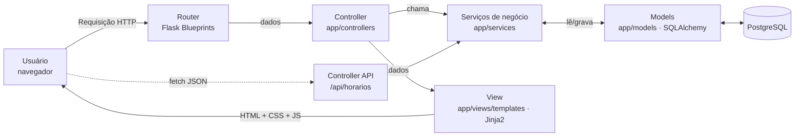

# 1. Arquitetura — padrão MVC em camadas

> Situação-Problema 2: "Desenvolver o código de processamento de dados, ou seja, o back-end
> dessa aplicação utilizando o design pattern indicado (MVC)."

## 1.1 Visão geral



É o mesmo fluxo da Figura 2 do material teórico (Usuário → Router → Controller ↔ Model → View →
HTML). O **Model** foi dividido em duas partes:

- `app/models/` — **entidades** persistentes (mapeamento objeto-relacional com SQLAlchemy);
- `app/services/` — **regras de negócio**, sem nenhuma dependência de HTTP. Por isso podem ser
  testadas sozinhas e reutilizadas pela tela, pela API e pelos comandos de terminal.

## 1.2 Estrutura de pastas

```text
app/
├── __init__.py            # application factory: cria e configura o Flask
├── config.py              # configurações (via variáveis de ambiente)
├── extensions.py          # SQLAlchemy, LoginManager, CSRFProtect
├── cli.py                 # comandos: flask init-db | seed | criar-admin
├── seed.py                # dados de demonstração
├── models/                # MODEL — entidades
│   ├── usuario.py  cliente.py  profissional.py  servico.py
│   ├── agendamento.py     # + StatusAgendamento (máquina de estados)
│   └── feedback.py
├── services/              # MODEL — regras de negócio
│   ├── agenda_service.py  # RN01–RN10, horários livres
│   ├── cadastro_service.py# RN11–RN14
│   ├── feedback_service.py# validação dos prints
│   ├── painel_service.py  # indicadores
│   └── excecoes.py        # RegraNegocioError
├── forms/                 # validação de entrada (WTForms) + CSRF
├── controllers/           # CONTROLLER — um blueprint por recurso
│   ├── auth.py  painel.py  clientes.py  servicos.py  profissionais.py
│   ├── agendamentos.py  usuarios.py  feedback.py
│   ├── api.py             # JSON para o JavaScript
│   └── erros.py           # páginas de erro 400/403/404/405/413/500
├── utils/                 # validadores (CPF, telefone), filtros de exibição, fuso horário
└── views/                 # VIEW
    ├── templates/         # HTML (Jinja2): base, macros e uma pasta por recurso
    └── static/            # css/app.css · js/app.js · js/agendamento.js
database/schema.sql        # projeto físico (PostgreSQL)
tests/                     # unit/ · integration/ · e2e/
```

## 1.3 Responsabilidades de cada camada

| Camada | Faz | Não faz |
|---|---|---|
| **View** (templates + CSS + JS) | Apresenta dados, valida formato no navegador (feedback imediato), máscaras, busca horários via `fetch` | Não decide regra de negócio (a validação do navegador é só conforto: o servidor sempre valida de novo) |
| **Controller** | Recebe a requisição, valida o formulário, chama o serviço, escolhe a view, transforma `RegraNegocioError` em mensagem | Não acessa regra de negócio diretamente nem monta SQL |
| **Service** (Model) | Aplica as regras (conflitos, horários, transições de status) e grava | Não conhece HTTP, sessão nem HTML |
| **Model** (entidades) | Mapeia tabelas, relacionamentos e restrições | — |
| **Banco** | Garante integridade mesmo se a aplicação falhar (domínios, FKs, CHECK, EXCLUDE) | — |

## 1.4 Exemplo de ponta a ponta: "Criar agendamento"

1. **View** — `agendamentos/form.html` mostra o formulário; `agendamento.js` chama
   `GET /api/horarios` e desenha os horários livres.
2. **Controller** — `controllers/agendamentos.py::novo()` valida o `AgendamentoForm` e chama:

   ```python
   agendamento = agenda_service.criar_agendamento(
       cliente_id=form.cliente_id.data, profissional_id=form.profissional_id.data,
       servico_id=form.servico_id.data,
       inicio=datetime.combine(form.data.data, parse_hora(form.hora.data)),
       observacoes=form.observacoes.data, usuario=current_user,
   )
   ```

3. **Service** — `agenda_service.criar_agendamento()` carrega as entidades, aplica as regras
   RN01–RN06 em `validar_horario()` e grava. Se algo estiver errado, lança
   `RegraNegocioError(mensagem, campo="hora")`.
4. **Controller** — captura o erro e o coloca **no campo** correspondente (`aplicar_erro`), ou
   redireciona para o detalhe com a mensagem de sucesso (padrão *Post/Redirect/Get*, que evita
   duplicar o agendamento ao recarregar a página).

## 1.5 Tratamento de erros

| Tipo | Onde é tratado | O que o usuário vê |
|---|---|---|
| Formato de campo | Navegador (`app.js`) **e** servidor (WTForms) | Mensagem abaixo do campo |
| Regra de negócio | Serviço → `RegraNegocioError` → controller | Mensagem no campo ou no topo da página |
| Violação no banco (concorrência) | `agenda_service._salvar` captura `IntegrityError` | "Esse horário acabou de ser ocupado…" |
| Sessão expirada na API | `unauthorized_handler` → JSON 401 | "Sua sessão expirou…" na área de horários |
| 400/403/404/405/413/500 | `controllers/erros.py` | Página amigável (ou JSON nas rotas `/api`); o erro 500 é registrado em log sem expor detalhes |

## 1.6 Bibliotecas utilizadas

| Biblioteca | Uso |
|---|---|
| Flask 3 | Framework web (rotas, templates Jinja2) |
| Flask-SQLAlchemy / SQLAlchemy 2 | ORM — mapeamento objeto-relacional |
| psycopg 3 | Driver do PostgreSQL |
| Flask-Login | Sessão do usuário autenticado |
| Flask-WTF / WTForms | Formulários, validação e proteção CSRF |
| Werkzeug | Hash de senhas, servidor de desenvolvimento |
| python-dotenv | Carrega o `.env` |
| gunicorn | Servidor de produção |
| pytest, pytest-cov | Testes e cobertura |
| Playwright | Testes E2E em navegador real |

O **front-end não usa framework nem CDN**: HTML, CSS e JavaScript escritos à mão
(`app/views/static`), cumprindo o requisito de codificação tradicional da interface.

## 1.7 Decisões de projeto

| Decisão | Alternativa considerada | Motivo |
|---|---|---|
| Flask com MVC explícito | Django (padrão MVT) | Deixa as camadas do MVC visíveis nas pastas, como pede a disciplina |
| Regras em `services/` | Regras dentro das rotas | Testáveis sem HTTP; reaproveitadas por tela, API e CLI |
| Renderização no servidor + JS progressivo | SPA (React/Vue) | Menos complexidade; funciona mesmo se o JS falhar |
| Validação dupla (app + banco) | Só na aplicação | O banco protege contra concorrência e erros futuros de código |
| Prints no banco (bytea) | Disco do servidor | Hospedagens gratuitas apagam o disco a cada deploy |
| Datas locais (sem fuso) + `FUSO_HORARIO` | Armazenar UTC | Negócio local de um único fuso; leitura mais simples para o usuário |
