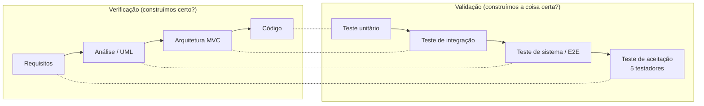

# 1. Plano de testes

## 1.1 Estratégia — Modelo V

Cada etapa de construção tem um nível de teste correspondente:



| Nível | O que verifica | Ferramenta | Onde |
|---|---|---|---|
| **Revisão / inspeção** (verificação estática) | Código × especificação, segurança, padrões | Leitura e revisão de código, matriz de rastreabilidade | `docs/situacao-1-planejamento/02-requisitos.md` |
| **Unitário** | Regras de negócio e funções isoladas (RN01–RN14, validadores) | pytest | `tests/unit/` |
| **Integração** | Controller + Service + Model + Banco + View (HTTP real com o cliente de teste do Flask) | pytest | `tests/integration/` |
| **Integração com o SGBD** | Domínios, CHECKs, FKs e restrição de exclusão no PostgreSQL | pytest + PostgreSQL | `tests/integration/test_postgres.py` |
| **Sistema / E2E** | Front-end (HTML/CSS/JS) no navegador real, servidor real, CSRF ligado | pytest + Playwright (Edge/Chromium) | `tests/e2e/` |
| **Aceitação** | O sistema atende quem vai usar? | 5 testadores + formulário de laudo | `docs/situacao-3-testes-validacao/feedbacks/` |

## 1.2 Técnicas de projeto de casos de teste

- **Partição de equivalência** — CPFs válidos × inválidos; telefones fixos × celulares × inválidos.
- **Análise de valor-limite** — atendimento que termina **exatamente** às 20:00 (aceito) × às 20:30
  (recusado); horários encostados (10:00–11:00 e 11:00–12:00) não conflitam; duração 5 e 480;
  3 prints (aceito) × 4 (recusado); 2 MB.
- **Tabela de transição de estados** — todas as transições válidas e as inválidas do agendamento.
- **Testes negativos e de segurança** — acesso sem login, acesso de atendente à área
  administrativa, CSRF ausente, *open redirect*, arquivo falso com extensão `.png`, upload acima do limite.

## 1.3 Critérios

| Critério | Meta |
|---|---|
| Entrada | Funcionalidade implementada e com requisito identificado |
| Saída (verificação) | 100% dos testes automatizados passando; cobertura ≥ 80% |
| Saída (validação) | 5 laudos recebidos; todo defeito relatado classificado (corrigido ou justificado) |
| Ambiente | Windows 11 + Python 3.14 + PostgreSQL 18 + Edge (local); Ubuntu + Python 3.13 + PostgreSQL 17 + Chromium (GitHub Actions) |

## 1.4 Como executar

```powershell
pytest -v                                    # tudo
pytest --cov=app --cov-report=term-missing   # com cobertura
$env:TEST_PG_URL = "postgresql+psycopg://..." ; pytest -m postgres
```
